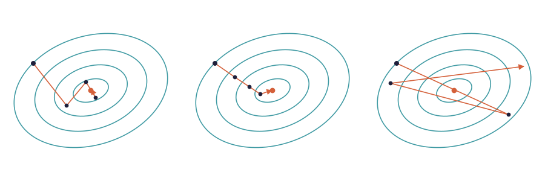

# Prerequisites: Gradient and Convexity

This chapter reviews two tools we return to again and again in the next one: the gradient of a function and the notion of convexity.

## The gradient

Let $f : \mathbb{R}^n \to \mathbb{R}$ be differentiable. The **gradient** of $f$ at $x$ is the vector of partial derivatives:

$$\nabla f(x) = \left( \frac{\partial f}{\partial x_1}(x), \dots, \frac{\partial f}{\partial x_n}(x) \right).$$

::: proposition
For $f(x) = \tfrac12 x^\top A x$ with $A$ symmetric we have $\nabla f(x) = A x$.
:::

::: simple
The gradient always points where the function **climbs fastest**. To go down, step in the direction $-\nabla f$.
:::

## Convexity

::: definition
A function $f$ is **$\mu$-strongly convex** if for all $x, y$:

$$f(y) \ge f(x) + \nabla f(x)^\top (y - x) + \tfrac{\mu}{2} \lVert y - x \rVert^2 .$$
:::

::: correction
In the class notes the condition read $\mu \ge 0$; "strongly convex" requires $\mu > 0$ ($\mu = 0$ is plain convexity).
:::

# Gradient Descent

Gradient descent minimizes $f$ by repeatedly stepping against its gradient, and it is the workhorse of modern machine learning.

## The update rule

For a step size $\eta > 0$ the iteration is

$$x_{k+1} = x_k - \eta \, \nabla f(x_k), \qquad k = 0, 1, 2, \dots$$



::: simple
Take too big a step and you jump over the valley and drift away; take too small a step and you arrive, but late. The art is the balance.
:::

## Convergence

::: theorem
If $f$ is $\mu$-strongly convex with $L$-Lipschitz gradient and $\eta \le 1/L$, then

$$\lVert x_k - x^\star \rVert^2 \le (1 - \eta \mu)^k \, \lVert x_0 - x^\star \rVert^2 .$$
:::

::: proof
Expand $\lVert x_{k+1} - x^\star \rVert^2$, use strong convexity, then simplify with $\eta \le 1/L$.
:::

::: example
For $f(x) = \tfrac12 \lVert x \rVert^2$ we have $\mu = L = 1$. With $\eta = 1$ one step suffices: $x_1 = x_0 - x_0 = 0$.
:::

## Implementation

```python
import numpy as np

def gradient_descent(grad, x0, eta=0.1, steps=200):
    """Plain fixed-step gradient descent."""
    x = np.asarray(x0, dtype=float)
    for _ in range(steps):
        x = x - eta * grad(x)
    return x

print(gradient_descent(lambda x: x, [4.0, -2.0]))
```

Choose `eta` below $2/L$; larger steps diverge.

## Exercises

1. Show that for $f(x) = \tfrac12 x^\top A x$ with $A \succ 0$ the best constant step is $\eta = 2/(\lambda_{\min} + \lambda_{\max})$.
2. Why does $f(x_k)$ plotted on a log scale give a straight line under linear convergence?
