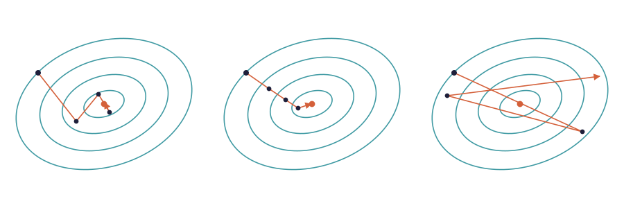

# پیش‌نیاز: گرادیان و تحدب

این فصل دو ابزار را مرور می‌کند که در فصل بعد بارها به آن‌ها برمی‌گردیم: گرادیان یک تابع و مفهوم تحدب.

## گرادیان

فرض کنیم $f : \mathbb{R}^n \to \mathbb{R}$ مشتق‌پذیر باشد. **گرادیان** $f$ در نقطهٔ $x$ برداری است با مؤلفه‌های مشتق‌های جزئی:

$$\nabla f(x) = \left( \frac{\partial f}{\partial x_1}(x), \dots, \frac{\partial f}{\partial x_n}(x) \right).$$

::: proposition
برای $f(x) = \tfrac12 x^\top A x$ با $A$ متقارن داریم $\nabla f(x) = A x$.
:::

::: simple
گرادیان همیشه به سمتی اشاره می‌کند که تابع در آن سمت **سریع‌تر از همه بالا می‌رود**. پس برای پایین آمدن باید در جهت $-\nabla f$ قدم برداشت.
:::

## تحدب

::: definition
تابع $f$ را **$\mu$-به‌شدت محدب** می‌نامیم هرگاه برای هر $x, y$ داشته باشیم:

$$f(y) \ge f(x) + \nabla f(x)^\top (y - x) + \tfrac{\mu}{2} \lVert y - x \rVert^2 .$$
:::

::: correction
در جزوهٔ کلاس شرط به‌صورت $\mu \ge 0$ آمده بود؛ برای «به‌شدت محدب» باید $\mu > 0$ باشد ($\mu = 0$ فقط تحدب ساده است).
:::

# کاهش گرادیان

کاهش گرادیان تابع $f$ را با برداشتن گام‌های پیاپی در خلاف جهت گرادیان کمینه می‌کند و پایهٔ یادگیری ماشین امروزی است.

## قاعدهٔ به‌روزرسانی

برای طول گام $\eta > 0$ تکرار به این صورت است:

$$x_{k+1} = x_k - \eta \, \nabla f(x_k), \qquad k = 0, 1, 2, \dots$$



::: simple
اگر گام را خیلی بزرگ بگیرید، از روی دره می‌پرید و دور می‌شوید؛ اگر خیلی کوچک بگیرید، می‌رسید ولی دیر. باید بین این دو تعادل پیدا کرد.
:::

## همگرایی

::: theorem
اگر $f$ به‌شدت محدب با گرادیان $L$-لیپشیتز باشد و $\eta \le 1/L$، آنگاه

$$\lVert x_k - x^\star \rVert^2 \le (1 - \eta \mu)^k \, \lVert x_0 - x^\star \rVert^2 .$$
:::

::: proof
عبارت $\lVert x_{k+1} - x^\star \rVert^2$ را بسط دهید و از تحدب قوی استفاده کنید؛ سپس با شرط $\eta \le 1/L$ ساده کنید.
:::

::: example
برای $f(x) = \tfrac12 \lVert x \rVert^2$ داریم $\mu = L = 1$. با $\eta = 1$ یک قدم کافی است: $x_1 = x_0 - x_0 = 0$.
:::

## پیاده‌سازی

```python
import numpy as np

def gradient_descent(grad, x0, eta=0.1, steps=200):
    """Plain fixed-step gradient descent."""
    x = np.asarray(x0, dtype=float)
    for _ in range(steps):
        x = x - eta * grad(x)
    return x

print(gradient_descent(lambda x: x, [4.0, -2.0]))
```

مقدار `eta` را کمتر از $2/L$ انتخاب کنید؛ گام‌های بزرگ‌تر واگرا می‌شوند.

## تمرین

1. نشان دهید برای $f(x) = \tfrac12 x^\top A x$ با $A \succ 0$ بهترین گام ثابت برابر $\eta = 2/(\lambda_{\min} + \lambda_{\max})$ است.
2. چرا نمودار $f(x_k)$ در مقیاس لگاریتمی برای همگرایی خطی خط راست می‌شود؟
